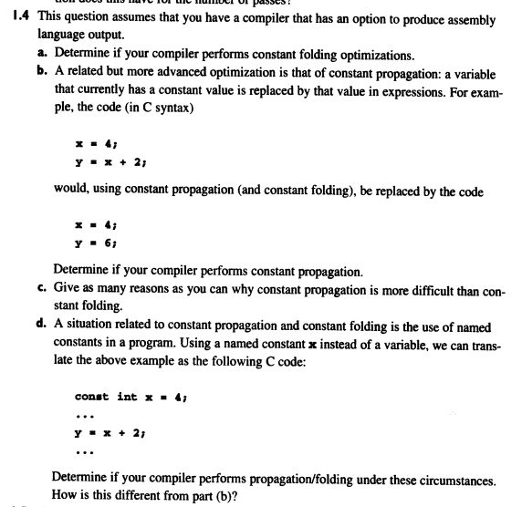

# Enunciado original de tarea con GCC

**Remitente:** Francisco Torres <torresrojas.cursos.02@gmail.com>  
**Enviado:** 2026-08-27T16:57:54-06:00  
**Recibido:** 2026-08-27T16:58:15-06:00  
**Fuente:** [[COM UCR] Tarea Corta en Grupos de Proyecto](https://mail.google.com/mail/u/0/#all/1a0ee048f6dc9ae2)

## Texto del correo

Resolver el ejercicio mostrado al final de este mensaje usando GCC en Linux como caso de estudio. Capturen pantallazos de las ejecuciones de GCC que se necesitan para armar sus respuestas.

Preparen un documento LATEX con todo su trabajo, en el estilo que prefieran pero de gran calidad. Entregar impreso al inicio de la clase del Jueves 3 de septiembre. Envíen además el fuente de LATEX y los archivos necesarios a este correo antes de la clase respectiva.

Si el trabajo no cumple estas especificaciones o si viene sin enunciados, sin nombres o con la información incompleta tienen un cero de inmediato.

