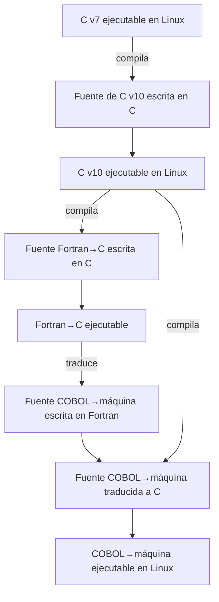

# Compiladores — preguntas y respuestas de los quices

**Alcance:** quices 01–05 transcritos de las fotografías facilitadas; el último quiz **no se aplicó** y sus preguntas son recuerdos parciales, no una transcripción. Las respuestas desarrollan los conceptos y no reproducen las respuestas manuscritas corregidas. Los ejemplos de programación son soluciones de estudio. Fecha de revisión: 28 de septiembre de 2026.

## Quiz 01 — 20 de agosto

### 1. Defina *amathia*. ¿Qué importancia tiene en los estudios universitarios?

*Amathia* se usa aquí para la ignorancia acompañada de la falsa seguridad de saber: una persona no reconoce las lagunas de su conocimiento y, por ello, no las investiga. No equivale simplemente a desconocer algo ni exige afirmar que toda ignorancia sea voluntaria. En la universidad importa porque distinguir «sé esto», «lo supongo» y «no lo sé» permite estudiar, contrastar fuentes y corregir errores. Por ejemplo, memorizar una regla de DFA incorrecta y negarse a probarla con contraejemplos impide aprenderla.

### 2. Defina detalladamente los conceptos indicados

| Concepto | Respuesta |
|---|---|
| John McCarthy | Investigador decisivo para la inteligencia artificial: fue uno de los autores de la propuesta del encuentro de Dartmouth y desarrolló LISP. En el curso conecta IA con la historia de los lenguajes. |
| *First Draft of a Report on the EDVAC* | Informe de John von Neumann de 1945 sobre el diseño de EDVAC; describe la organización de una computadora de programa almacenado, con instrucciones y datos en memoria. **Es sobre EDVAC, no sobre ENIAC.** El informe se atribuye a von Neumann, aunque la historia del diseño incluye las contribuciones de Eckert, Mauchly y otros. |
| Maurice Wilkes | Dirigió el desarrollo de EDSAC en Cambridge, que ejecutó programas en 1949; también propuso la microprogramación como método de implementar el control de instrucciones. |
| FORTRAN | Lenguaje de alto nivel orientado originalmente al cálculo científico y numérico; permite expresar fórmulas, variables, arreglos y control de flujo mediante un compilador. Lo desarrolló un equipo de IBM dirigido por John Backus para el IBM 704. No es correcto expandir su nombre como *Formal Translation*: procede de *Formula Translation*. |
| Ciclo de *fetch* | Parte del ciclo de instrucción en que la CPU usa el contador de programa para leer de memoria la próxima instrucción y cargarla en el registro de instrucción; después vienen su decodificación y ejecución, y se actualiza el contador según corresponda. |
| LISP | Familia de lenguajes iniciada por McCarthy, centrada históricamente en expresiones simbólicas y listas; usa expresiones S y se relaciona con la investigación temprana en IA. *List Processing* explica el nombre. |
| Grace Murray Hopper | Pionera de compiladores y lenguajes: trabajó en A-0 y en FLOW-MATIC, antecedente influyente de COBOL. **No fue la única creadora de COBOL.** |
| Unidad de control alambrada | Implementa las señales de control de la CPU mediante circuitos lógicos fijos que responden a las instrucciones y al estado, en vez de generar esas señales mediante una secuencia de microinstrucciones. |
| Productividad frente a eficiencia | **Productividad del programador:** cuánto software útil puede construir y mantener por unidad de esfuerzo. **Eficiencia de ejecución:** recursos que consume el programa al ejecutarse, como tiempo y memoria. Una notación más cómoda puede ahorrar trabajo humano aunque el programa use más recursos. |

**Referencias:** [Computer History Museum: First Draft](https://www.computerhistory.org/revolution/birth-of-the-computer/4/88/359), [EDSAC y Wilkes](https://www.computerhistory.org/revolution/story/95), [Grace Hopper y A-0](https://www.computerhistory.org/timeline/1952/), [IBM: John Backus](https://www.ibm.com/history/john-backus), [IBM: FORTRAN](https://www.ibm.com/history/fortran), [IBM: historia de IA](https://www.ibm.com/think/topics/history-of-artificial-intelligence).

## Quiz 02 — 24 de agosto

### 1. ¿Qué importancia tiene Chomsky en la cultura universal? ¿Qué es su gramática universal?

Noam Chomsky cambió el estudio del lenguaje al proponer gramáticas **generativas**: reglas explícitas capaces de describir la estructura de un conjunto potencialmente ilimitado de oraciones. Su trabajo hizo central la pregunta de cómo adquiere un niño un sistema lingüístico complejo. También influyó en la lingüística, las ciencias cognitivas y las formas de describir sintaxis formal. La **gramática universal** es la hipótesis de que los humanos comparten una disposición o principios de la facultad del lenguaje que restringen qué gramáticas pueden adquirir; no es una lengua única hablada por todos ni una lista fija de reglas idénticas en cada idioma. La formulación concreta de esos principios ha cambiado y sigue siendo objeto de investigación. [Chomsky, *Linguistic Contributions to the Study of Mind*](https://chomsky.info/mind01/); [MIT, Chomsky sobre la facultad del lenguaje](https://calendar.mit.edu/event/genuine_explanation_and_the_strong_minimalist_thesis_noam_chomsky_virtual_lecture).

### 2. Describa el IBM 701 Speedcoding System de Backus

Fue un **sistema interpretativo** desarrollado por John Backus y colaboradores para facilitar cálculos numéricos en el IBM 701, en particular operaciones de punto flotante que esa máquina no ofrecía directamente como las del posterior IBM 704. El programador escribía seudoinstrucciones de mayor nivel y el intérprete ejecutaba las rutinas correspondientes. Mejoraba la productividad de programación a cambio de tiempo de ejecución y memoria: **Speedcoding no era el compilador de FORTRAN**. [IBM: John Backus](https://www.ibm.com/history/john-backus); [documento histórico IBM 701 Speedcoding](https://archive.computerhistory.org/resources/text/Fortran/102653983.05.01.acc.pdf).

### 3. Programa VOLE: sumar `B0`–`BF` en `A` y dejar el promedio truncado en `F`

**Límite del enunciado:** son 16 bytes sin signo y su suma matemática puede ser `16 × FF₁₆ = 4080`, mientras un registro VOLE guarda un byte (`0`–`255`). Por ello, ningún programa puede dejar **toda** la suma en `A` para *todas* las entradas. El siguiente programa deja `A = suma mod 256`, que es la suma completa si no supera `255`, y calcula **siempre** `F = ⌊suma/16⌋` sin perder acarreo.

Se usa `x = 16q + r`, con `q = x >> 4` y `r = x & 0F`. Al sumar 16 bytes: `promedio = Σq + ⌊Σr/16⌋`. Tanto `Σq` como `Σr` caben por separado en un byte (`≤240`). Para extraer `q`, se rota el byte cuatro posiciones a la derecha y se aplica la máscara `0F`. La división final de `Σr` se hace del mismo modo.

| Dirección | Código | Significado |
|---|---|---|
| `00` | `20C0` | `R0 ← C0` (límite posterior a `BF`) |
| `02` | `2200` | `R2 ← 0` (suma de cocientes) |
| `04` | `2300` | `R3 ← 0` (suma de residuos) |
| `06` | `260F` | `R6 ← 0F` (máscara) |
| `08` | `2701` | `R7 ← 1` |
| `0A` | `28B0` | `R8 ← B0` (dirección actual) |
| `0C` | `2A00` | `RA ← 0` (byte bajo de la suma) |
| `0E` | `11B0` | `R1 ← M[B0]`; el operando `B0` se modifica en cada vuelta |
| `10` | `5AA1` | `RA ← RA + R1` módulo 256 |
| `12` | `8416` | `R4 ← R1 AND R6` (residuo) |
| `14` | `5334` | `R3 ← R3 + R4` |
| `16` | `4015` | `R5 ← R1` |
| `18` | `A504` | rotar `R5` cuatro bits a la derecha |
| `1A` | `8556` | `R5 ← R5 AND 0F` (cociente) |
| `1C` | `5225` | `R2 ← R2 + R5` |
| `1E` | `5887` | `R8 ← R8 + 1` |
| `20` | `B826` | si `R8 = R0 = C0`, ir al final |
| `22` | `380F` | guardar `R8` en `M[0F]`: sustituye la dirección del `LOAD` en `0E` |
| `24` | `B00E` | volver incondicionalmente a `0E` (`R0 = R0`) |
| `26` | `4034` | `R4 ← R3` |
| `28` | `A404` | rotar cuatro bits a la derecha |
| `2A` | `8446` | `R4 ← R4 AND 0F`, equivalente a `⌊Σr/16⌋` |
| `2C` | `5F24` | `RF ← R2 + R4` |
| `2E` | `C000` | detener |

Cada instrucción ocupa dos bytes. La escritura a `0F` **modifica la segunda celda de la instrucción** `11B0`; por ejemplo, `11B0 → 11B1`. Los 16 datos deben ocupar `B0`–`BF`, lejos del código `00`–`2F`. `A` y `F` en el enunciado son números de registro, no direcciones de memoria. Ejemplos: dieciséis bytes `FF` producen `A=F0` (4080 mod 256) y `F=FF` (255); los bytes `00`–`0F` producen `A=78` (120) y `F=07` (7). Verificación: se simuló la secuencia para esos casos, cero y 5000 entradas aleatorias, comparando con la suma modular y la división entera. [MIT OCW, arquitectura e instrucciones Brookshear/VOLE](https://ocw.mit.edu/courses/16-01-unified-engineering-i-ii-iii-iv-fall-2005-spring-2006/4f6720b954a910be2f3d94fa6ea707e9_2.pdf).

## Quiz 03 — 3 de septiembre

### 1. Defina *linking* dinámico, diccionario de relocalización y *backpatching*

| Término | Respuesta y ejemplo |
|---|---|
| Enlazado dinámico (*dynamic linking*) | El programa usa bibliotecas compartidas cuyas referencias son resueltas por el cargador/enlazador dinámico al cargar o durante la ejecución; por ejemplo, una llamada a `printf` puede dirigirse al símbolo de una biblioteca compartida. No es «enlazar archivos al compilar», pues esa frase describe el enlace en general. |
| Diccionario o tabla de relocalización | Registros que indican **qué ubicación** de código/datos requiere un ajuste, **a qué símbolo/sección** se refiere y **qué tipo** de ajuste corresponde cuando el objeto recibe direcciones definitivas. Ejemplo: la posición de una llamada cuyo destino `f` está definido en otro archivo objeto. |
| *Backpatching* | Dejar temporalmente sin resolver un campo o una lista de saltos adelantados y completarlos cuando ya se conoce la dirección de destino; por ejemplo, emitir «si falso, saltar a ?» y rellenar `?` al generar la rama `else`. También es distinto de construir un compilador que se compila a sí mismo (*bootstrapping*). |

Las entradas de relocalización usadas por el enlazador y los huecos de saltos que completa el generador de código se parecen porque difieren el cálculo de un destino, pero ocurren en contextos distintos. [GNU BFD: estructura de relocalización](https://www.sourceware.org/binutils/docs/bfd/typedef-arelent.html); [GNU ld](https://sourceware.org/binutils/docs/ld.html).

### 2. Compare el Zurich Compiler Kit y el Amsterdam Compiler Kit: semejanzas, diferencias y objetivos

En este contexto, «kit de Zúrich» se refiere al mecanismo **Pascal-P / P-code** de portabilidad asociado al desarrollo de Pascal en Zúrich; conviene comprobar si el profesor asignó a esa expresión un alcance más específico. Ambos separan el lenguaje fuente de los detalles de una máquina concreta mediante una **representación intermedia** y facilitan el transporte de compiladores.

| Aspecto | Kit de Zúrich / Pascal-P | Amsterdam Compiler Kit (ACK) |
|---|---|---|
| Entrada | Principalmente Pascal. | Diversos lenguajes mediante frentes separados. |
| Intermedio | P-code para una máquina virtual de pila. | EM, representación intermedia común. |
| Portabilidad | Llevar Pascal a otra plataforma implementando el soporte de la máquina P y, según la variante, adaptando/compilando el sistema. | Añadir un frente para un lenguaje o un backend para otra máquina y reutilizar los demás componentes. |
| Objetivo característico | Difundir/transportar una implementación de Pascal. | Construir una familia de compiladores e intérpretes portables con reutilización entre lenguajes y destinos. |

No se debe reducir ACK a «compiladores de Pascal» ni concluir que todo P-code *necesariamente* se ejecuta de forma nativa: puede interpretarse o traducirse. [Pascal Implementation: la máquina P](https://homepages.cwi.nl/~steven/pascal/book/10pcode.html); [Tanenbaum y colaboradores, *A Practical Tool Kit for Making Portable Compilers*](https://tack.sourceforge.net/olddocs/toolkit.html) ([copia del artículo en el repositorio](readings/ACK.pdf)).

### 3. Compiladores en Linux: versión 7, fuente C de versión 10, traductor Fortran→C en C y compilador COBOL→máquina escrito en Fortran

**Regla del diagrama T:** la barra superior representa `lenguaje de entrada → lenguaje de salida` y el pie el **lenguaje en que está implementado** el compilador; una vez compilado, el pie corresponde a la máquina/plataforma donde puede ejecutarse. Para usar un compilador en fuente, primero debe existir un ejecutable capaz de compilar su lenguaje de implementación.

| Paso | Herramienta disponible | Acción | Resultado ejecutable en Linux |
|---|---|---|---|
| 1 | Compilador C v7 ya ejecutable; fuente C de C v10 | Compilar la fuente de v10 con v7. | C v10, primer ejecutable. |
| 2 | C v10 del paso 1 y su fuente C | Recompilar v10 con v10 (*bootstrapping*), si se busca la versión autocompilada. | C v10 recompilado; no suponer que por ello sea automáticamente más rápido o correcto. |
| 3 | Fuente C del traductor Fortran→C | Compilarla con el C disponible, idealmente v10. | Traductor Fortran→C. |
| 4, **si se dispone del fuente Fortran** del compilador COBOL | Traductor Fortran→C y compilador C | Traducir ese fuente a C y compilar el C generado. | Compilador COBOL→máquina ejecutable en Linux, si el código generado y sus bibliotecas son compatibles. |

Un solo esquema de composición para el caso en que (c) incluya **fuente Fortran**:



En notación T, las cabezas de los tres traductores finales son `C→máquina`, `Fortran→C` y `COBOL→máquina`; sus pies son respectivamente `C` antes de compilar, `C` antes de compilar y `Fortran` antes de traducir/compilar. Tras obtener los ejecutables, los pies son la plataforma Linux correspondiente. El esquema muestra dependencias; la recompilación opcional de C v10 con sí mismo queda en el paso 2 de la tabla.

**Matiz imprescindible del inciso (c):** el enunciado fotografiado dice «un compilador de Cobol, escrito en Fortran, que genere lenguaje máquina»; **no afirma explícitamente que se entregue su fuente**. Si es ya un binario compatible con Linux y su arquitectura, se ejecuta directamente, sin traducir su implementación. Si es un binario incompatible y no se tiene el fuente Fortran, los archivos (a) y (b) no bastan para reconstruirlo. «Lenguaje máquina» también debe ser el de la arquitectura objetivo deseada; un compilador cruzado podría producir código para otra máquina. El diagrama final debe etiquetar en cada etapa fuente, destino, implementación y máquina anfitriona. [Princeton: problema de arranque de compiladores](https://www.cs.princeton.edu/research/techreps/151); [ejemplo académico de transporte de Pascal y diagramas T](https://www.cs.ru.ac.za/compilerbook/CSharpAndJava/book2005/book2005text/chap03.htm).

## Quiz 04 — 7 de septiembre

### 1. Defina *pidgin*, *creole*, afasia de Broca, BEV y LSN

| Concepto | Respuesta |
|---|---|
| *Pidgin* | Variedad de contacto que se desarrolla para comunicarse entre grupos sin una lengua compartida; normalmente no empieza como lengua materna de una comunidad. No equivale a «mezcla al azar». |
| *Creole* (lengua criolla) | Lengua plenamente desarrollada surgida en un contexto de contacto lingüístico y transmitida como lengua comunitaria o materna. La explicación tradicional la vincula con la nativización de un pidgin, pero **no todas las trayectorias históricas se reducen a esa secuencia**. |
| Afasia de Broca | Trastorno adquirido del lenguaje que suele afectar especialmente la producción fluida; la expresión puede ser lenta y trabajosa y la comprensión suele estar relativamente mejor preservada, aunque puede presentar dificultades. No significa pérdida total de inteligencia ni se reduce a un problema muscular de pronunciación. |
| BEV | *Black English Vernacular*, nombre histórico de una variedad de inglés afroamericano; actualmente suele hablarse de AAVE/AAE. Tiene patrones fonológicos y gramaticales sistemáticos: no es «inglés sin gramática» ni simplemente un pidgin. |
| LSN | Lengua de Señas Nicaragüense: lengua de señas surgida en la comunidad de personas sordas de Nicaragua, con cambios gramaticales observados entre cohortes de señantes. Es una lengua natural visual-gestual, no un código de español palabra por palabra. |

**Referencias:** [NIDCD: afasia](https://www.nidcd.nih.gov/es/espanol/afasia), [investigación original sobre LSN](https://siegler.tc.columbia.edu/wp-content/uploads/2020/08/Children_Creating_Language_How_Nicaraguan_Sign_Lan.pdf), [estudio de AAVE en *Proceedings of the Linguistic Society of America*](https://journals.linguisticsociety.org/proceedings/index.php/PLSA/article/view/5288), [debate sobre el origen de las lenguas criollas](https://journals.linguisticsociety.org/proceedings/index.php/PLSA/article/view/5948).

### 2. En el proyecto MICRO, explique cómo se implementaron la E/S y las expresiones condicionales

**Entrada y salida, según el código del proyecto:** el [scanner](projects/project0/scanner.c) reconoce `read`, `write`, identificadores y puntuación; el [parser](projects/project0/parser.c) reconoce `READ(id_list);` y `WRITE(expr_list);`, procesa cada elemento en orden y llama a `read_id` / `write_expr` de [semantic.c](projects/project0/semantic.c). [codegen.c](projects/project0/codegen.c) genera ensamblador x86-64: para `read(x)` pasa la dirección de `micro_var_x` en `%rsi`, el formato `%d` en `%rdi`, pone `%eax=0` y llama a `scanf@PLT`; para `write(E)` carga el valor en `%esi`, pasa `%d\n` en `%rdi`, pone `%eax=0` y llama a `printf@PLT`. Las variables y temporales se reservan en `.bss`. La entrada es decimal con signo de 32 bits; cada salida ocupa una línea. Por ejemplo, `read(x); write(x+1);` con entrada `4` imprime `5`.

**Condicional del ejercicio 10:** su sintaxis es `(E1 | E2 | E3)`; si `E1 ≠ 0`, el resultado es `E2`, y si `E1 = 0`, es `E3`. En `primary()` el parser obtiene el primer valor, crea un contexto con un temporal y dos etiquetas, y genera primero una comparación con cero y salto a la etiqueta falsa. Tras compilar `E2`, guarda el resultado en el temporal y salta al final; después emite la etiqueta falsa, compila `E3`, guarda su resultado en **el mismo temporal** y coloca la etiqueta final. En ejecución **solo se evalúa la rama elegida**. Ejemplo: `(0 | 10 | 20)` vale 20. El proyecto emite ensamblador durante el descenso recursivo, **sin AST ni IR separados**; [main.c](projects/project0/main.c) llama a GCC para ensamblar/enlazar y luego ejecuta el programa generado. [README del proyecto](projects/project0/README.md).

## Quiz 05 — 14 de septiembre

### 1. Diagrama secuencial de las fases de un compilador típico; explicación breve

```text
Fuente → análisis léxico → análisis sintáctico → análisis semántico
       → representación intermedia → optimización → generación de código
       → código objeto → enlace/carga → programa ejecutable
```

| Etapa | ¿Qué hace? | Ejemplo |
|---|---|---|
| Análisis léxico | Agrupa caracteres en tokens y detecta errores léxicos. | `total := 3` → `ID`, `:=`, `ENTERO`. |
| Análisis sintáctico | Verifica el orden de los tokens según la gramática y construye una estructura sintáctica o activa acciones de traducción. | Rechaza `:= total 3`. |
| Análisis semántico | Comprueba restricciones de significado estático, como declaraciones y tipos. | Rechaza sumar tipos incompatibles si el lenguaje lo prohíbe. |
| Representación intermedia (IR) | Expresa el programa en una forma útil para analizarlo y transformarlo, independiente o parcialmente independiente de la máquina. | Temporal `t1 := a + b`. |
| Optimización | Transforma la IR o el código conservando la semántica observable para mejorar alguna métrica. | Sustituye `2+3` por `5` cuando es válido. |
| Generación de código | Selecciona instrucciones y ubicaciones para el destino, y produce ensamblador o código objeto. | `add` para un destino específico. |
| Ensamblado, enlace y carga | El ensamblador codifica instrucciones; el enlazador combina objetos y resuelve símbolos; el cargador prepara el proceso. Son pasos de la **cadena de herramientas**, no siempre fases internas del compilador. | Resolver una referencia a `printf`. |

La tabla de símbolos y el manejo de errores colaboran con varias etapas. La secuencia es **típica**, no obligatoria: el compilador MICRO de este repositorio genera ensamblador sin AST o IR separado; además, una optimización puede ocurrir en más de un punto. [README de MICRO](projects/project0/README.md); [notas de lexing de Cornell](https://www.cs.cornell.edu/courses/cs4120/2026sp/notes.html?id=lexing).

## Último quiz — no aplicado; preguntas recordadas

### 1. Propiedades de un DFA y «elemento neutro»

La pregunta exacta no está disponible. Lo que sí se recuerda se responde así:

- Un DFA es la quíntupla `M = (Q, Σ, δ, q₀, F)`: estados finitos, alfabeto, función `δ: Q × Σ → Q`, estado inicial y estados finales. Para cada estado y símbolo del alfabeto hay **exactamente un** siguiente estado; si falta una flecha en un dibujo, se añade un estado sumidero cuando se requiere la función total.
- La transición extendida sobre hileras cumple `δ̂(q, ε)=q` y `δ̂(q, wa)=δ(δ̂(q,w),a)`; se acepta `w` si `δ̂(q₀,w)∈F`. Así, `ε` es aceptada exactamente cuando `q₀∈F`.
- El **elemento neutro de concatenar hileras** es la hilera vacía `ε`: `εw=wε=w`. El **elemento neutro de concatenar lenguajes** es el lenguaje `{ε}`: `L{ε}={ε}L=L`. El lenguaje vacío `∅` es absorbente en esa operación: `L∅=∅`.
- La igualdad `δ̂(q,ε)=q` no crea una «transición ε» en el DFA: expresa que no consumir ningún símbolo no cambia el estado.

Ejemplo: si `q₀` no es final, se rechaza `ε`; si `δ(q₀,E)=q₁` y `q₁` es final, se acepta `E` aunque se rechace `ε`. [Cornell: definición y transición extendida](https://www.cs.cornell.edu/courses/cs2800/2017sp/lectures/lec22-dfa.html); [OpenDSA: hileras y concatenación](https://opendsa-server.cs.vt.edu/ODSA/StandaloneModules/20221129164143/html/FLConcepts.html).

### 2. Prefijos y sufijos de `ECCI`

Definiciones: `p` es prefijo de `w` si `w=px` para alguna `x`; `s` es sufijo si `w=xs` para alguna `x`.

| Longitud | Prefijo | Sufijo |
|---:|---|---|
| 0 | `ε` | `ε` |
| 1 | `E` | `I` |
| 2 | `EC` | `CI` |
| 3 | `ECC` | `CCI` |
| 4 | `ECCI` | `ECCI` |

Por tanto, `Pref(ECCI)={ε,E,EC,ECC,ECCI}` y `Suf(ECCI)={ε,I,CI,CCI,ECCI}`. Si se piden **propios**, se excluye la hilera completa `ECCI`; `ε` sigue siendo propio de una hilera no vacía. Ejemplo de comprobación: `ECC` es prefijo porque `ECCI=ECC·I`; `CCI` es sufijo porque `ECCI=E·CCI`. [`prefixes(s)` en una definición formal, Cornell](https://www.cs.cornell.edu/~jnfoster/papers/lstar-with-blanks.pdf).

**Preguntas restantes del quiz no aplicado:** no se recuerdan y no hay un enunciado que permita reconstruirlas sin inventar contenido.
